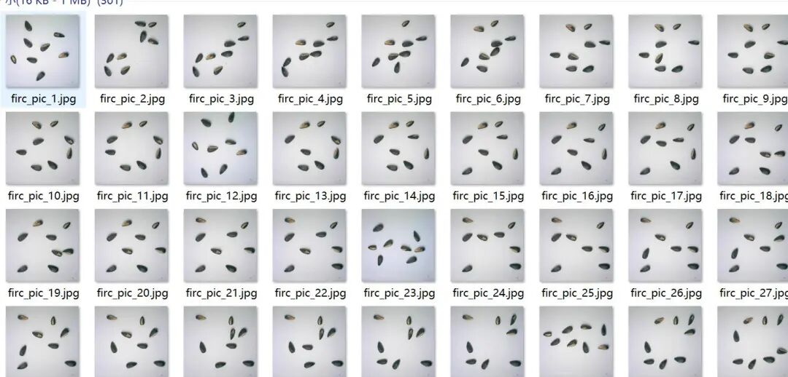
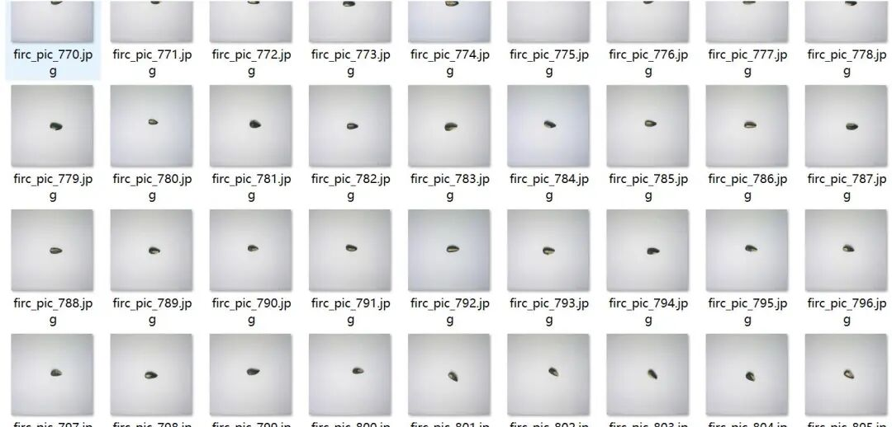
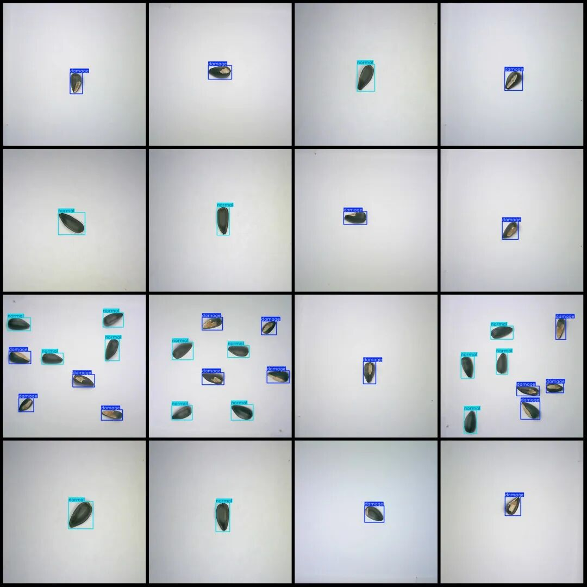
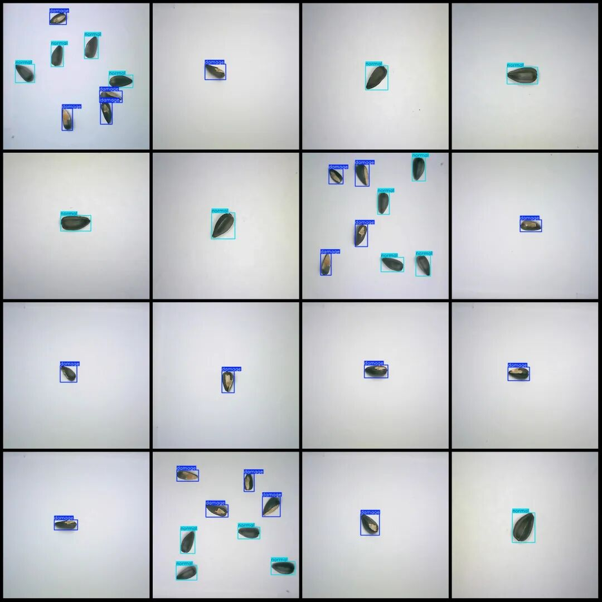

# Hemp Seed Quality Detection Hemp Seed Goods and Bads Detection Dataset VOC+YOLO Format 1000 Images 2 Categories

Dataset format: Pascal VOC format + YOLO format (txt file without split path, only containing jpg images and corresponding VOC format xml files and yolo format txt files)

Number of images (number of jpg files): 1000

Number of annotations (number of xml files): 1000

Number of annotations (number of txt files): 1000

Labeling category count: 2

Label category names (Note that the order of categories in the YOLO format does not correspond to this, but is based on the classes.txt file in the labels folder): ["damage", "normal"]

Number of boxes labeled in each category:

Damage Frames = 1213

Normal frame count = 1203

Total frame count: 2416

Number of images per category:

Damage count = 600

Normally, the number of images owned = 600

Image resolution: 640x640

Using labelImg:

Annotation rules: Draw a rectangle around the category.

Important Notice: The dataset does not have separate training, validation, and test sets; you need to partition them yourself.

Special : This dataset does not guarantee the accuracy of the trained models or weight files.

Image Preview:

Annotation example:

## Payment

Here is a pay link on Stripe ( https://buy.stripe.com/3cs8yP7sY87d0vu9AB ). Please contact me lonlonago@foxmail.com after funding $89, and I will send you a complete data files , thank you!

